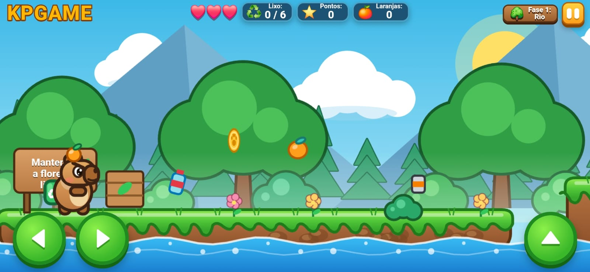

<h1 align="center">🌲 KPGAME - Salve a Floresta! 🦫</h1>

<p align="center">
  
</p>

<p align="center">
  
  
  
  
</p>

---

### 🚀 Sobre o Projeto
O **KPGAME** é um jogo de plataforma 2D mobile desenvolvido para a plataforma **Android** com foco na **conscientização ambiental**. No controle de uma capivara equipada com uma mochila de reciclagem, o jogador embarca em uma jornada para limpar rios, combater desmatamentos, desmantelar armadilhas de caça, limpar aterros e salvar animais ameaçados pela pesca ilegal[cite: 15, 16].

Embora utilize tecnologias web (`HTML5` e `JavaScript`) em sua engine gráfica, o projeto está estruturado e configurado como um **aplicativo Android nativo** gerenciado pelo Android Studio (`Gradle/Kotlin DSL`).

<p align="center">
  
</p>

### 🚀 Sobre o Projeto
O **KPGAME** é um jogo de plataforma 2D mobile desenvolvido para a plataforma **Android** com foco na **conscientização ambiental**. No controle de uma capivara equipada com uma mochila de reciclagem, o jogador embarca em uma jornada para limpar rios, combater desmatamentos, desmantelar armadilhas de caça, limpar aterros e salvar animais ameaçados pela pesca ilegal.

Embora utilize tecnologias web (`HTML5` e `JavaScript`) em sua engine gráfica, o projeto está estruturado e configurado como um **aplicativo Android nativo** gerenciado pelo Android Studio (`Gradle/Kotlin DSL`).

---

### 🗺️ Fases e Missões do Jogo
O jogo conta com 5 fases temáticas progressivas:
1. **🌳 Fase 1: Rio** — Detenha o poluidor da fábrica que está sujando as águas do rio.
2. **🪵 Fase 2: Mata** — Enfrente o lenhador com motosserra para proteger a vegetação nativa.
3. **🦅 Fase 3: Caça** — Resgate animais presos em gaiolas e desvie das armadilhas do caçador.
4. **🗑️ Fase 4: Aterro** — Recolha todo o lixo espalhado e enfrente o caminhão do aterro a céu aberto.
5. **🎣 Fase 5: Pesca** — Corte as redes de pesca ilegais e liberte peixes, tartarugas e patos de volta à natureza.

---

### ✨ Principais Funcionalidades
* **Aplicativo Android Nativo:** Estrutura completa de projeto mobile pronta para compilação (`.apk` / `.aab`).
* **Mecânicas de Plataforma:** Sistema de pulo simples/duplo, física de gravidade e mecânica de natação/flutuação.
* **Áudio Dinâmico Integrado:** Efeitos e trilha sonora gerados via Web Audio API.
* **Controles Mobile Otimizados:** D-pad virtual e botões de toque na tela integrados ao ambiente Android.
* **Sistema de Ranking Local (`localStorage`):** Tabela de pontuação salva no dispositivo.

---

### 💻 Tecnologias Utilizadas
* **Mobile / IDE:** Android Studio, Gradle (`build.gradle.kts`)
* **Engine / Frontend:** HTML5 Canvas, JavaScript (ES6+), CSS3
* **Áudio:** Web Audio API

---

### ⚙️ Como Executar o Projeto

1. **Clone o repositório:**
   ```bash
   git clone [https://github.com/thiagoyagame/KPGAME.git](https://github.com/thiagoyagame/KPGAME.git)
