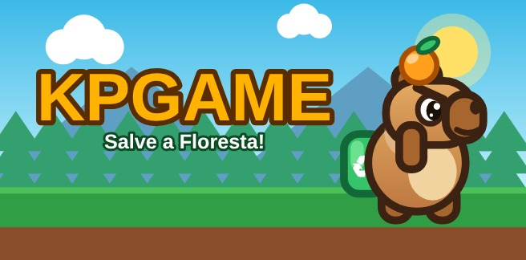

<h1 align="center">🌲 KPGAME - Salve a Floresta! 🦫</h1>

  

  
  
  
  

---

### 🚀 Sobre o Projeto
O **KPGAME** é um jogo de plataforma 2D mobile desenvolvido para a plataforma **Android** com foco na **conscientização ambiental**. No controle de uma capivara equipada com uma mochila de reciclagem, o jogador embarca em uma jornada para limpar rios, combater desmatamentos, desmantelar armadilhas de caça, limpar aterros e salvar animais ameaçados pela pesca ilegal[cite: 15, 16].

Embora utilize tecnologias web (`HTML5` e `JavaScript`) em sua engine gráfica, o projeto está estruturado e configurado como um **aplicativo Android nativo** gerenciado pelo Android Studio (`Gradle/Kotlin DSL`).

  

